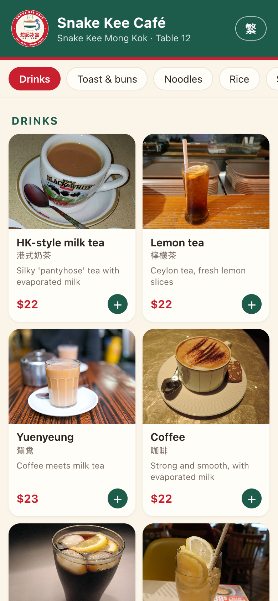
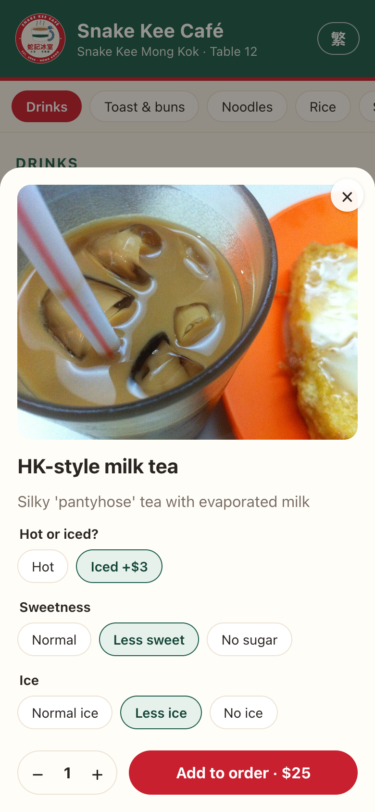

<p align="center"></p>

# 蛇記冰室 Snake Kee Café

**Branch your database like you branch your code, then run your Django tests on a copy of production.**

A QR-code ordering app for a (fictional) Hong Kong cha chaan teng, built with **Django + React** on
**[Lakebase](https://docs.databricks.com/aws/en/oltp/projects/)**, Databricks' serverless Postgres.
It's the demo from the PyCon Hong Kong 2026 talk *"Lakebase: Rethinking Serverless Postgres for AI Agents and Python Developers"*.

<p align="center">
  
  
  
</p>

## The idea in one screen

```text
# on git branch feat/one-member-per-email, after adding unique=True to Customer.email:

$ python manage.py test                        $ LAKEBASE=1 python manage.py test
Creating test database for alias 'default'...  🌿 Lakebase branch 'feat-one-member-per-email': a copy of production data
Ran 7 tests                                    ✗ Your migrations fail on production data:
OK                                               IntegrityError: could not create unique index "customers_email_…_uniq"
                                                 DETAIL:  Key (email)=(chantaiman@example.hk) is duplicated.
        a brand-new EMPTY database                          a copy of production, created in seconds
```

Django's test runner gives you a perfectly clean, empty database every time. Production isn't clean.
With Lakebase, every git branch can get its own **copy-on-write branch of production**: real data, isolated,
created in seconds regardless of size, deleted automatically after a TTL. Same code, same command, different data.

> *Your tests deserve production data. Your production doesn't deserve your tests.*

## What's Lakebase-specific? Three small files

Everything else is stock Django, React and Postgres.

| File | What it does |
|---|---|
| [`snakekee/lakebase.py`](snakekee/lakebase.py) | git branch → Lakebase branch (created from `production` with a TTL), its host, and short-lived OAuth tokens |
| [`snakekee/db/base.py`](snakekee/db/base.py) | Django's PostgreSQL backend + a fresh token per connection (10 lines) |
| [`snakekee/testrunner.py`](snakekee/testrunner.py) | `LAKEBASE=1` → run the tests on this branch's data instead of an empty test database |

Plus a [`post-checkout` git hook](.githooks/post-checkout): after `git checkout -b feat/x` it creates the Lakebase branch
for you (on every other checkout it just checks the branch exists).

A Lakebase branch is just a Postgres connection string, so the same idea works with SQLAlchemy/Alembic, pytest, or anything else.

## Try it yourself (≈15 minutes)

You need: [uv](https://docs.astral.sh/uv/) (it installs Python 3.12 for you), Node 22+,
the [Databricks CLI](https://docs.databricks.com/aws/en/dev-tools/cli/install), and a Databricks workspace with
Lakebase, for example [Databricks Free Edition](https://www.databricks.com/learn/free-edition) (tested; see
[docs/free-edition.md](docs/free-edition.md) for idle endpoints).
Works on macOS and Linux; on Windows use WSL (the git hook is a bash script).

```bash
# 1. log in, and create a Lakebase project (it comes with a `production` branch and a `databricks_postgres` database)
databricks auth login --host https://<your-workspace>.cloud.databricks.com --profile snake-kee
databricks postgres create-project snake-kee-demo --profile snake-kee     # or: UI → Lakebase → New project

# 2. get the code
git clone https://github.com/conraddd/pycon-hk-2026-snake-kee snake-kee && cd snake-kee
cp .env.example .env            # set LAKEBASE_PROJECT=snake-kee-demo and DATABRICKS_CONFIG_PROFILE=snake-kee
uv sync
git config core.hooksPath .githooks

# 3. create the schema and fake data on `production` (scale 0.01 ≈ 55k orders, ~20 s)
LAKEBASE_BRANCH=production uv run python manage.py migrate
LAKEBASE_BRANCH=production uv run python manage.py seed --scale 0.01     # asks before it deletes anything

# 4. run the app (Django API on :8000, React on :5173)
uv run python manage.py runserver                 # terminal 1: the API (uses the `dev` branch, created on first use)
cd frontend && npm install && npm run dev         # terminal 2: open http://localhost:5173/?shop=1&table=12
```

Then follow [**DEMO.md**](DEMO.md) to break and fix a migration on a branch of production.

## How it works

```text
 git branch                     Lakebase branch                     what uses it
 ───────────────────────        ──────────────────────────────      ──────────────────────────
 main / master                  dev            (24h TTL)            runserver, makemigrations
 feat/one-member-per-email  →   feat-one-member-per-email (TTL)      LAKEBASE=1 manage.py test
 (Databricks App)               production                          the deployed app
```

* **Branches are copy-on-write.** A new branch shares production's storage and only stores what changes,
  so creating one takes seconds no matter how big the database is. Each branch has its own compute, which scales to zero.
* **TTL**: auto-created branches expire after `LAKEBASE_BRANCH_TTL_HOURS` (default 24), so nothing is left behind.
* **Small, sleepy compute**: each new branch autoscales between `LAKEBASE_MIN_CU` and `LAKEBASE_MAX_CU` (default 0.5 to 2 CU) and scales to zero after `LAKEBASE_SUSPEND_MINUTES` (default 5) without connections. The first query after a sleep wakes it up, which takes a moment.
* **Tokens**: the Postgres password is a short-lived OAuth token from your Databricks login, cached in `.lakebase/` (git-ignored).
* **`LAKEBASE=1 manage.py test`** sets Django's test database to *be* the branch and always uses `--keepdb`:
  Django applies only your new migrations, wraps each test in a rolled-back transaction, and never creates or drops a database.
  The runner refuses to run against `production`, and refuses `TransactionTestCase` on a branch (it would empty the tables).
* Plain `manage.py test` is stock Django: it creates an empty `test_databricks_postgres` database next to your branch's data
  (that's why your Lakebase role needs to be able to create databases, which the project owner can).
* Migrations that **succeed** on a branch stay applied there. Want a fresh copy? `uv run python -m snakekee.lakebase reset`.

### Commands

| Command | |
|---|---|
| `uv run python -m snakekee.lakebase info` | which branch / host this checkout uses |
| `uv run python -m snakekee.lakebase ensure` | create the branch for the current git branch (the hook does this) |
| `uv run python -m snakekee.lakebase reset` | throw the branch away, take a fresh copy of production |
| `uv run python -m snakekee.lakebase list` / `delete [branch]` | housekeeping (`production` can't be deleted from here) |
| `uv run python manage.py members chantaiman` | compare 蛇記 Rewards members across branches (`LAKEBASE_BRANCH=production …`) |
| `LAKEBASE_BRANCH=production uv run python manage.py seed --scale 0.01` | reseed `production` (deletes shop data, asks first) |
| `uv run python tools/menu_art.py` | regenerate the logo and fallback illustrations (photos win when `<slug>.jpg` exists) |

## Deploy as a Databricks App

```bash
uv run python scripts/deploy_app.py
```

Creates the app with a Lakebase resource on `production` (which gives the app's service principal a Postgres role),
grants it read/insert/update on the tables (including future ones), sets `LAKEBASE_PROJECT` in `app.yaml`,
uploads the code and deploys. The app runs `gunicorn` (see [`app.yaml`](app.yaml));
Databricks Apps runs `uv sync` and `npm run build` for you.

## Things worth knowing

* **Production data in tests means production data on your laptop.** For anything real, branch from a masked or
  sanitised source branch (`LAKEBASE_SOURCE_BRANCH`) and control who can create branches. Everything here is synthetic.
* **Latency**: tests talk to Lakebase over the network. Keep branch tests focused (migrations, data contracts);
  keep your fast unit tests local.
* **This is not a replacement** for unit tests, fixtures or testcontainers. It's the layer above them:
  *does my change survive production's data?*
* The demo app has no authentication and exempts its API from CSRF. Don't put it on the internet as is.
* The demo's "fix" migrations rewrite data and can't be reversed. That's fine on a branch, which is the point:
  run them on a branch first, and back up before running anything like them on production.

## See also

* [Lakebase agent demo](https://github.com/db-afeng/lakebase_agent_demo) by Alex Feng: Lakebase branches for coding agents, one per git worktree.

## Credits

Menu photos: [Wikimedia Commons](https://commons.wikimedia.org/) contributors, under CC0 / CC BY / CC BY-SA / public domain;
see [`frontend/public/menu/CREDITS.md`](frontend/public/menu/CREDITS.md) (also linked from the app). The logo and the fallback
illustrations are generated SVG (`tools/menu_art.py`). 蛇記冰室 is fictional; any resemblance to your favourite 茶餐廳 is a compliment.
